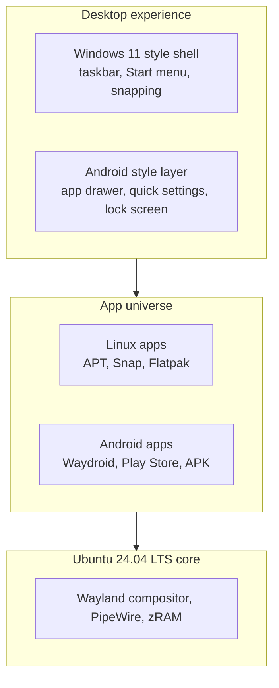

<div align="center">


# AetherOS

### The unified operating system for everyone

**Ubuntu stability. A Windows 11 style desktop. Android 14 apps. All on a 4 GB PC.**

<br>

[](#license)
[](#under-the-hood)
[](#features)
[](#get-started)

<br>

<table>
  <tr>
    <td align="center"><b>~380 MB</b><br><sub>idle RAM</sub></td>
    <td align="center"><b>4 GB</b><br><sub>target RAM</sub></td>
    <td align="center"><b>14 to 16 GB</b><br><sub>target storage</sub></td>
    <td align="center"><b>~1.9 GB</b><br><sub>ISO download</sub></td>
  </tr>
</table>

<br>

[Features](#features) &nbsp;·&nbsp; [Low-end PCs](#built-for-low-end-pcs) &nbsp;·&nbsp; [Under the hood](#under-the-hood) &nbsp;·&nbsp; [Get started](#get-started) &nbsp;·&nbsp; [Build the ISO](#build-the-iso) &nbsp;·&nbsp; [Design](#brand-and-design-system) &nbsp;·&nbsp; [License](#license)

</div>

---

## Why AetherOS

Three software worlds usually mean three machines, or one machine that struggles. **AetherOS puts them in one lightweight system**: the rock-solid base of Ubuntu, the desktop layout most people already know from Windows 11, and the huge app catalog of Android 14.

It is tuned for budget laptops and older desktops, so a PC with **4 GB of RAM and a 16 GB drive** still feels fast and has room left for your files.

## Features

### Windows 11 style desktop

- Centered, fluent **taskbar** with live running indicators, thumbnail previews and a system tray
- Acrylic style **Start menu** with universal search across apps, files, Android APKs and the web
- **AetherOS Files**, an Explorer style file manager with familiar `C:\` and `D:\` drive paths and dual-pane navigation
- Window snapping with `Super` + arrow keys
- Personalization tools: **AetherOS Tweaks** (Windhawk style) and **AetherOS Widgets** (Rainmeter style)

### Android 14 apps

- Native containerized Android subsystem powered by **Waydroid**, with GPU acceleration
- **Google Play Store**, Google Play Services and a low-memory **MicroG** setup
- Full-screen Android style **app drawer** with categorized tabs
- Slide-down **quick settings and notification shade** with interactive pills
- Ambient **lock screen** with PIN and swipe to unlock

### Ubuntu Linux core

- Built on **Ubuntu 24.04 LTS (Noble Numbat)** with 5+ years of security updates
- Two terminals in one: a Linux **Bash/Zsh** power terminal and a **PowerShell** compatible console
- Install software with **APT, Snap, Flatpak**, or sideload Android **APKs** directly
- **PipeWire** audio and a low-latency **Wayland** compositor

## Built for low-end PCs

AetherOS is engineered for machines with **4 GB of RAM** and **14 to 16 GB of storage**.

| | Standard OS (Ubuntu / Windows 11) | **AetherOS Low-End Edition** |
|---|---|---|
| **Idle RAM use** | 1,500 to 2,800 MB | **~380 to 450 MB** |
| **Free RAM on a 4 GB PC** | Less than 1.5 GB | **Over 3.5 GB for your apps** |
| **Virtual memory** | Slow disk swap | **zRAM** (LZ4 compressed RAM swap) |
| **Install size on disk** | 25 to 40 GB | **4.8 to 6.0 GB** |
| **ISO download** | 4.5 to 6.0 GB | **~1.8 to 2.1 GB** |
| **Free space left on a 16 GB drive** | 0 GB (does not fit) | **~10 GB for user files** |
| **Browser memory** | Default behavior | Aggressive idle tab suspension |

> [!TIP]
> **zRAM** keeps swapped pages compressed in memory instead of writing them to a slow disk. On older hardware this is the difference between a smooth desktop and a frozen one.

## Under the hood



## Apps and browsers

### Pick your browser during setup

The Calamares installer lets you choose the browser you want:

| Browser | Best for |
|---|---|
| **Google Chrome** | Google account sync |
| **Mozilla Firefox** | Enhanced tracking protection and privacy |
| **Microsoft Edge** | Vertical tabs and Copilot integration |
| **Opera** | Built-in free VPN and sidebar messengers |

### Pre-installed apps

<details>
<summary><b>Android subsystem</b></summary>

Google Play Store, Play Services, AetherOS Android Manager, APK Installer.

</details>

<details>
<summary><b>Productivity</b></summary>

LibreOffice Suite (Writer, Calc, Impress), AetherOS Files, PDF Viewer.

</details>

<details>
<summary><b>Creativity and media</b></summary>

VLC Media Player, GIMP Photo Retouching, Amberol Audio Player.

</details>

<details>
<summary><b>Development</b></summary>

Visual Studio Code, GNOME Terminal, Tilix Tiling Shell, Git, Python 3, Node.js.

</details>

<details>
<summary><b>Customization</b></summary>

AetherOS Widgets (Rainmeter style), AetherOS Tweaks (Windhawk style), Dark and Light theme switcher.

</details>

## Get started

**1. Download** the latest ISO from the [Releases page](https://github.com/AetherOS/AetherOS/releases).

**2. Write it to a USB stick** with [balenaEtcher](https://etcher.balena.io/), or from a Linux terminal:

```bash
sudo dd if=AetherOS-1.0-lowend-amd64.iso of=/dev/sdX bs=4M status=progress oflag=sync
```

> [!WARNING]
> Replace `/dev/sdX` with your USB device. `dd` erases everything on the target drive, so double check the name with `lsblk` first.

**3. Boot from the USB stick** and follow the Calamares installer. You will choose your browser and your drive on the way.

### Target hardware

| | |
|---|---|
| **Memory** | 4 GB RAM |
| **Storage** | 14 to 16 GB drive (the install itself takes 4.8 to 6.0 GB) |
| **Installer image** | ~1.8 to 2.1 GB |

## Build the ISO

The build system is designed to run on modest hardware.

```bash
# Clone the repository
git clone https://github.com/AetherOS/AetherOS.git
cd AetherOS

# Install minimal build dependencies
sudo make install-deps

# Build the compact Low-End PC ISO
sudo bash build/build-iso-lowend.sh
```

The finished image lands here (about 1.9 GB):

```text
build/output/AetherOS-1.0-lowend-amd64.iso
```

## Brand and design system

| Role | Color | Hex |
|---|---|---|
| Primary accent (Apex Royal Purple) |  | `#7C3AED` |
| Primary hover |  | `#6D28D9` |
| Dark background (Obsidian Purple) |  | `#1E1B2E` |
| Dark surface |  | `#2D2640` |
| Light background (Lavender Mist) |  | `#F5F0FF` |
| Light surface |  | `#FFFFFF` |

**Typography:** Inter for the interface, JetBrains Mono for the terminal.

## Contributing

Issues and pull requests are welcome.

1. Fork the repo and create a branch for your change
2. Test your change on low-end hardware or a VM with 4 GB of RAM
3. Open a pull request and describe what you changed and why

## License

AetherOS is free software licensed under the **GNU General Public License v3.0 (GPL-3.0)**.

Some optional components, such as the web browsers and Google Play Services, are proprietary and keep their own licenses.

---

<div align="center">

<sub>Built for the PCs everyone else gave up on. Formerly known as SatanOS / SatasOS.</sub>

<sub>Windows, Android, Google, Ubuntu and other product names are trademarks of their respective owners. AetherOS is an independent project and is not affiliated with or endorsed by them.</sub>

</div>
